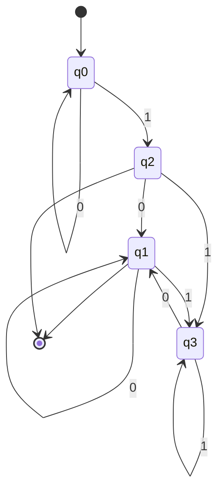
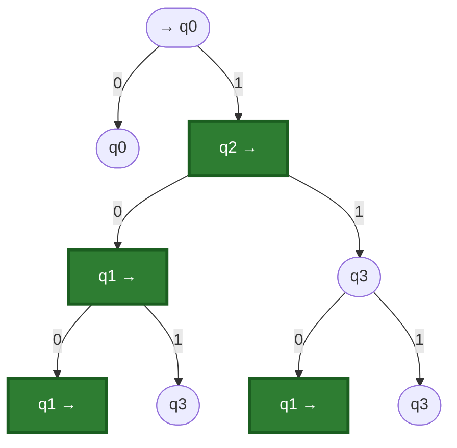

# Konečný automat

$$A = (Q, \Sigma, \delta, q_0, F)$$

- $Q = \{q_1, \dots, q_n\}$ – konečná množina **stavů**
- $\Sigma = \{a_1, a_2, \dots, a_m\}$ – **vstupní abeceda**
- $\delta \colon Q \times \Sigma \to Q$ – **přechodová funkce**, $\delta(q, a) = q'$, kde $q, q' \in Q$, $a \in \Sigma$
- $q_0 \in Q$ – **počáteční stav**
- $F \subseteq Q$ – množina **koncových** (přijímajících) **stavů**

Činnost: řídicí jednotka (ŘJ) ve stavu $q_i$ čte z pásky vstupní symbol $a_j$ a přejde do stavu $q_k$, tj. $(q_i, a_j) \to q_k$. Páska: $a_1 \mid a_2 \mid \dots \mid a_m$.

$\delta$ každé dvojici $(q_i, a_j) \in Q \times \Sigma$ přiřadí právě jeden stav z $Q$.

## Způsoby zadání automatu
1. Přechodová funkce
2. Tabulka
3. Stavový diagram
4. Stavový strom

## Příklad 1
$Q = \{q_0, q_1, q_2, q_3\}$, $\Sigma = \{0, 1\}$, počáteční stav $q_0$, $F = \{q_1, q_2\}$

### 1. Přechodová funkce
$$\delta(q_0, 0) = q_0, \quad \delta(q_0, 1) = q_2$$
$$\delta(q_1, 0) = q_1, \quad \delta(q_1, 1) = q_3$$
$$\delta(q_2, 0) = q_1, \quad \delta(q_2, 1) = q_3$$
$$\delta(q_3, 0) = q_1, \quad \delta(q_3, 1) = q_3$$

### 2. Tabulka
Šipka $\to$ označuje počáteční stav, šipka $\leftarrow$ koncový stav.

|                 | 0     | 1     |
| --------------- | ----- | ----- |
| $\to q_0$       | $q_0$ | $q_2$ |
| $\leftarrow q_1$ | $q_1$ | $q_3$ |
| $\leftarrow q_2$ | $q_1$ | $q_3$ |
| $q_3$           | $q_1$ | $q_3$ |

### 3. Stavový diagram

### 4. Stavový strom
Kořen je počáteční stav $q_0$, z každého uzlu vede hrana pro každý symbol z $\Sigma$.

Uzly označené šipkou „→“ za názvem (zelené) jsou koncové stavy ($\in F$), šipka „→ q0“ před názvem je počáteční stav.

### Zpracování slova $1011010$
| vstup | 1     | 0     | 1     | 1     | 0     | 1     | 0     |
| ----- | ----- | ----- | ----- | ----- | ----- | ----- | ----- |
| stav  | $q_2$ | $q_1$ | $q_3$ | $q_3$ | $q_1$ | $q_3$ | $q_1$ |

Začínáme v $q_0$ a končíme v $q_1 \in F$, takže slovo automat **přijímá**.

---

# Doplňující teorie (dopsáno z hlavy, ne z tabule)

> [!note] Tohle není z přednášky ani z fotek. Je to standardní teorie ke konečným automatům, která navazuje na probranou látku. Až se objeví na tabuli, porovnat a případně opravit značení.

## Deterministický konečný automat (DKA)
Automat $A = (Q, \Sigma, \delta, q_0, F)$ z minulé hodiny je **deterministický**, protože $\delta$ je funkce: pro každý stav a každý symbol existuje **právě jeden** následující stav. Proto je v tabulce v každém políčku právě jeden stav a ze stavu vede v diagramu pro každý symbol právě jedna šipka.

## Zobecněná (rozšířená) přechodová funkce $\delta^*$
Učitel ji značí $\delta^*$ (v jiné literatuře také $\hat\delta$). Podmínky 1 a 2 níže odpovídají tabuli (viz [[Pr-5]]).
Funkce $\delta$ zpracuje jen jeden symbol. Pro celé slovo ji rozšíříme na $\delta^* \colon Q \times \Sigma^* \to Q$:

$$\delta^*(q, \varepsilon) = q$$
$$\delta^*(q, wa) = \delta(\delta^*(q, w), a), \quad w \in \Sigma^*, \; a \in \Sigma$$

**Definice (zobecněná přechodová funkce).** Pro automat $A = (Q, \Sigma, \delta, q_0, F)$ je zobecněná přechodová funkce zobrazení $\delta^* \colon Q \times \Sigma^* \to Q$ definované indukcí podle délky slova:
1. $\delta^*(q, \varepsilon) = q$ pro každé $q \in Q$
2. $\delta^*(q, wa) = \delta(\delta^*(q, w), a)$ pro $q \in Q$, $w \in \Sigma^*$, $a \in \Sigma$

Na jednosymbolovém slově splývá s $\delta$: $\delta^*(q, a) = \delta(\delta^*(q,\varepsilon), a) = \delta(q, a)$.

Ekvivalentně lze číst slovo zleva: $\delta^*(q, aw) = \delta^*(\delta(q, a), w)$.

Příklad 1, slovo $10$: $\delta^*(q_0, 10) = \delta(\delta^*(q_0, 1), 0) = \delta(\delta(q_0,1), 0) = \delta(q_2, 0) = q_1$.

Význam: $\delta^*(q, w)$ je stav, ve kterém automat skončí, když začne ve stavu $q$ a přečte celé slovo $w$. Řádek „vstup / stavy“ na tabuli je přesně výpočet $\delta^*$ krok za krokem.

## Přijímání slova a jazyk automatu
Slovo $w$ je **přijato**, když $\delta^*(q_0, w) \in F$. Jazyk automatu:

$$L(A) = \{ w \in \Sigma^* \mid \delta^*(q_0, w) \in F \}$$

- Prázdné slovo $\varepsilon$ je přijato právě tehdy, když $q_0 \in F$.
- Slovo, které není přijato, je **zamítnuto** (skončí ve stavu mimo $F$).

## Jazyk příkladu 1
Dokud se čtou nuly, zůstává automat v $q_0 \notin F$. První jednička vede do $q_2 \in F$. Potom je stav určen posledním přečteným symbolem: po $0$ je to $q_1 \in F$, po $1$ je to $q_3 \notin F$. Proto

$$L(A) = \{ 0^k 1 \mid k \geq 0 \} \cup \{ w \in \{0,1\}^* \mid w \text{ obsahuje } 1 \text{ a končí } 0 \}$$

tedy slovo je přijato, když buď je tvaru $0^k 1$, nebo obsahuje alespoň jednu jedničku a končí nulou. Slovo $1011010$ končí nulou a obsahuje jedničku, takže je přijato. To souhlasí s tabulí.

## Úplný automat
Automat je **úplný**, když je $\delta$ definovaná pro všechny dvojice $(q, a) \in Q \times \Sigma$. Příklad 1 i příklad 2 (dveře) jsou úplné. Všechny čtyři způsoby zadání (funkce, tabulka, diagram, strom) popisují tentýž automat.
