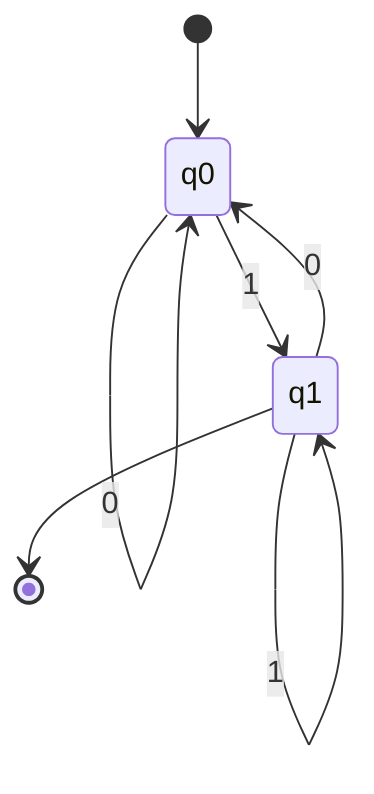
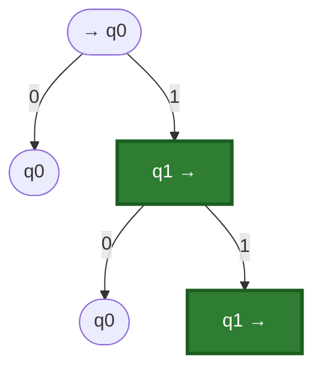
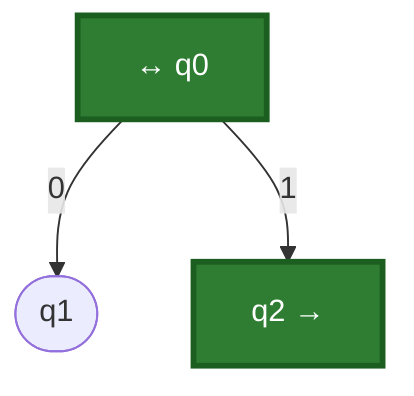

sigma def 
sigma+ def 

---

# Příklad 2 – automatická brána

Dvě polohy brány, např. na schématu úsečky:
- **zavřené** – stav $q_0$
- **otevřené** – stav $q_1$

Vstupní symboly:
- nikdo není – $0$
- je před (bránou) – $1$

$Q = \{q_0, q_1\}$, $\Sigma = \{0, 1\}$, počáteční stav $q_0$, $F = \{q_1\}$

## Tabulka
|                 | 0     | 1     |
| --------------- | ----- | ----- |
| $\to q_0$       | $q_0$ | $q_1$ |
| $\leftarrow q_1$ | $q_0$ | $q_1$ |

## Stavový diagram

## Stavový strom

Uzly označené šipkou „→“ za názvem (zelené) jsou koncové stavy ($\in F$), šipka „→ q0“ před názvem je počáteční stav.

## Zpracování slova $01001$
| vstup | 0     | 1     | 0     | 0     | 1     |
| ----- | ----- | ----- | ----- | ----- | ----- |
| stav  | $q_0$ | $q_1$ | $q_0$ | $q_0$ | $q_1$ |

Končíme v $q_1 \in F$, takže slovo automat **přijímá** (brána je na konci otevřená).

# Slova nad abecedou

$\Sigma = \{x_1, \dots, x_n\}$, $\Sigma^+$

- $\Sigma = \{0, 1\}$
- $\Sigma = \{a, b, c, \dots\}$, $\Sigma^+ = \{bca, ccda, \dots\}$ – množina všech **neprázdných** slov nad $\Sigma$
- $\varepsilon$ – **prázdné slovo**
- $\Sigma^* = \Sigma^+ \cup \{\varepsilon\}$ – množina všech slov včetně prázdného

## Délka slova
$|u_1 \dots u_n| = n$

- $|abcd| = 4$
- $|\varepsilon| = 0$

## Zřetězení slov
Pro $u = a_1 \dots a_n \in \Sigma^*$ a $v = b_1 \dots b_m \in \Sigma^*$ je

$$uv = a_1 \dots a_n b_1 \dots b_m$$

Příklad: $u = abc$, $v = cda$, pak $uv = abccda$.

Prázdné slovo je neutrální prvek zřetězení:
$$\varepsilon u = u \varepsilon = u$$

## Mocnina slova
- $u^0 = \varepsilon$
- $u^1 = u$
- $u^2 = uu$
- $u^{i+1} = u^i u$

# Jazyk nad abecedou $\Sigma$

**Jazyk** $L$ nad abecedou $\Sigma$ je libovolná množina slov nad $\Sigma$, tj. libovolná podmnožina $\Sigma^*$:

$$L \subseteq \Sigma^*$$

- $L = \emptyset$ je prázdný jazyk (neobsahuje žádné slovo)
- $L = \{\varepsilon\}$ je jazyk obsahující pouze prázdné slovo (není to totéž co $\emptyset$)
- $L = \Sigma^*$ je jazyk všech slov nad $\Sigma$

Příklad: pro $\Sigma = \{0, 1\}$ je $L = \{0, 01, 011, 0111, \dots\}$ jazyk slov začínajících nulou.

## Jazyk přijímaný automatem
Automat $A = (Q, \Sigma, \delta, q_0, F)$ přijímá slovo $w$, jestliže po jeho přečtení z $q_0$ skončí ve stavu z $F$. Jazyk přijímaný automatem $A$ je množina všech přijímaných slov:

$$L(A) = \{ w \in \Sigma^* \mid \text{po přečtení } w \text{ z } q_0 \text{ skončí } A \text{ ve stavu z } F \}$$

## Normální a zobecněná přechodová funkce (z tabule)
Pro automat $A = (Q, \Sigma, \delta, q_0, F)$ a jazyk $L \subseteq \Sigma^*$:

- **Normální** $\delta \colon Q \times \Sigma \to Q$, $\delta(q, a) = q'$, kde $q, q' \in Q$, $a \in \Sigma$ (čte jeden symbol)
- **Zobecněná** $\delta^* \colon Q \times \Sigma^* \to Q$, $\delta^*(q, w) = q'$, kde $w \in \Sigma^*$ (čte celé slovo)

Na tabuli je pod $a \in \Sigma$ ještě zapsáno $\delta(q, w) = q'$, $w \in \Sigma^*$, tedy zobecněná funkce psaná **bez hvězdičky**. Pro jeden symbol obě splývají, $\delta^*(q, a) = \delta(q, a)$, takže $\delta^*$ je rozšíření $\delta$ z jednoho symbolu na celé slovo a značí se někdy stejně.

Definice $\delta^*$ podmínkami (induktivně podle délky slova), $q \in Q$, $w \in \Sigma^*$, $a \in \Sigma$:
1. $\delta^*(q, \varepsilon) = q$
2. $\delta^*(q, wa) = \delta(\delta^*(q, w), a)$

Rozepsání pro slovo $w = a_1 a_2 a_3$ (v podmínce 2 je $w \to a_1 a_2$ a $a = a_3$):
$$\delta^*(q, a_1 a_2 a_3) = \delta(\delta(\delta(q, a_1), a_2), a_3)$$
Symboly se tedy zpracují postupně zleva, každý přečtený symbol posune automat do dalšího stavu pomocí $\delta$.

Výpočet na konkrétním automatu je v [[Pr-4]].

## Jazyk rozpoznatelný automatem (z tabule)
$$L(A) = \{ w \in \Sigma^* ;\; \delta^*(q_0, w) \in F \}$$

Podmínka $\delta^*(q_0, w) \in F$ znamená: $\delta^*(q_0, w) = q \;\land\; q \in F$.

Pro slovo $w = x_1 x_2 \dots x_m \in \Sigma^+$ platí:
$$w \in L(A) \iff \exists\, q_1, \dots, q_{m+1};\quad q_1 = q_0,\;\; q_{m+1} \in F,\;\; q_{i+1} = \delta(q_i, x_i)$$
(pro $i = 1, \dots, m$).

Zde je $q_1$ jiné označení počátečního stavu $q_0$ a $q_1, \dots, q_{m+1}$ jsou stavy, kterými automat při čtení slova projde (výpočet).

Zápis výpočtu do tabulky:

| vstup | $x_1$ | $x_2$ | $\dots$ | $x_m$ |
| ----- | ----- | ----- | -------- | ----- |
| stav $q_1$ | $q_2$ | $q_3$ | $\dots$ | $q_{m+1} \in F$ |

Slovo je přijato, když poslední stav $q_{m+1}$ leží v $F$. Příklad: slovo $1011010$ má výpočet $q_0, q_2, q_1, q_3, q_3, q_1, q_3, q_1$ a $q_1 \in F$.

### Příklad: slovo $010$ (z tabule)
Použité přechody (jen ty, které slovo využije):
$$\delta(q_0, 0) = q_1, \qquad \delta(q_1, 1) = q_1, \qquad \delta(q_1, 0) = q_3$$

| vstup | 0 | 1 | 0 |
| ----- | - | - | - |
| $q_0$ | $q_1$ | $q_1$ | $q_3 \in F$ |

$$\delta^*(q_0, 010) = q_3 \in F$$
Slovo $010$ je tedy přijato, $010 \in L(A)$. Ve výpočtu se $\delta^*$ rozepíše po symbolech: $\delta^*(q_0, 010) = \delta(\delta(\delta(q_0, 0), 1), 0) = \delta(\delta(q_1, 1), 0) = \delta(q_1, 0) = q_3$.

Automat z tohoto příkladu není na tabuli zadán celý, vidíme jen tyto tři přechody.

**Prázdné slovo:** $\varepsilon \in L(A) \iff q_0 \in F$. Proto se v ekvivalenci výše bere $w \in \Sigma^+$ zvlášť.

Na tabuli je to ilustrováno malým stromem, kde je počáteční stav $q_0$ zároveň koncový (označeno „$\leftrightarrow q_0$“): z něj vede $0$ do $q_1$ a $1$ do $q_2$, přičemž $q_2$ je koncový (šipka „→“).

Označení „↔“ znamená počáteční i koncový stav zároveň, proto je automat přijímá $\varepsilon$.

---

# Doplňující teorie (dopsáno z hlavy, ne z tabule)

> [!note] Tohle není z přednášky ani z fotek. Je to standardní teorie ke konečným automatům, která na probrané látce navazuje. Až se objeví na tabuli, porovnat a případně opravit značení.

Pojmy $\delta^*$, přijímání slova a $L(A)$ jsou vysvětleny v [[Pr-4]].

## Jazyk příkladu 2
**Příklad 2 (brána):** $q_1$ je stav „naposledy bylo na vstupu $1$“, $q_0$ je stav „naposledy $0$“ (a na začátku). Proto

$$L(A) = \{ w \in \{0,1\}^+ \mid w \text{ končí symbolem } 1 \}$$

Ověření: $01001$ končí jedničkou, takže je přijato, což souhlasí s tabulí.

## Operace s jazyky
Protože jazyk je množina, lze použít množinové operace. Navíc se definuje:

- **Zřetězení jazyků:** $L_1 L_2 = \{ uv \mid u \in L_1, \, v \in L_2 \}$
- **Mocnina jazyka:** $L^0 = \{\varepsilon\}$, $L^{i+1} = L^i L$
- **Iterace (Kleeneho hvězdička):** $L^* = \bigcup_{i=0}^{\infty} L^i$
- **Pozitivní iterace:** $L^+ = \bigcup_{i=1}^{\infty} L^i$
- **Doplněk** vzhledem k $\Sigma$: $\overline{L} = \Sigma^* \setminus L$

Poznámka: $\Sigma^*$ z definice slov je speciální případ iterace, kde se za jazyk vezme množina jednosymbolových slov $\Sigma$.

## Další pojmy, které se obvykle probírají dál
- **Regulární jazyk** je jazyk, který přijímá nějaký konečný automat.
- **Úplný automat** má $\delta$ definovanou pro všechny dvojice $(q, a)$. Naše automaty z hodin jsou úplné.
- **Nedeterministický automat (NKA)** může mít ve stavu pro symbol více možných přechodů (nebo žádný). Přijímá stejnou třídu jazyků jako DKA, tu lze převést podmnožinovou konstrukcí.
- **Minimalizace automatu** hledá ekvivalentní automat s nejmenším počtem stavů.
