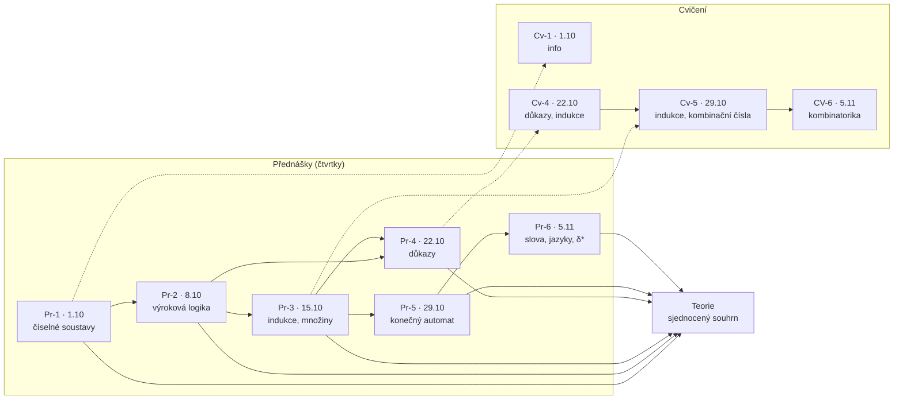

---
tags:
  - prehled
---

# Přehled poznámek a vztahů

> [!note] Jak číst
> Plné šipky ukazují, **na co co navazuje** (látka). Čárkované ukazují, **co se cvičilo** z které přednášky. Vztahy jsou odvozené z obsahu poznámek, ne od učitele. Nahlédnutí do grafu Obsidianu: `Ctrl+G` (graf se opírá o odkazy `[[...]]` níže).

## Graf vztahů

## Vztahy slovy
| odkud | kam | proč |
| ----- | --- | ---- |
| Pr-2 → Pr-4 | výroková logika → důkazy | důkaz implikace, obměna a spor vychází z pravdivostních tabulek |
| Pr-3 → Pr-5 | množiny → automat | $Q$, $\Sigma$, $F$ jsou množiny, $\delta$ je funkce na kartézském součinu $Q \times \Sigma$ |
| Pr-5 → Pr-6 | automat → slova, jazyk | $\delta^*$ a $L(A)$ jsou postavené na $\delta$ a $\Sigma^*$ |
| Pr-4 → Cv-4 | důkazy → cvičení | přímý důkaz, spor, indukce |
| Pr-3 → Cv-5 | indukce → cvičení | součet $1+2+\dots+n$ |
| Cv-5 → CV-6 | kombinační čísla → variace a permutace | faktoriál a krácení |

## Odkazy (pro graf Obsidianu)
**Přednášky:** [[Pr-1]] · [[Pr-2]] · [[Pr-3]] · [[Pr-4]] · [[Pr-5]] · [[Pr-6]]
**Cvičení:** [[Cv-1]] · [[Cv-4]] · [[Cv-5]] · [[CV-6]]
**Souhrn:** [[Teorie]]
